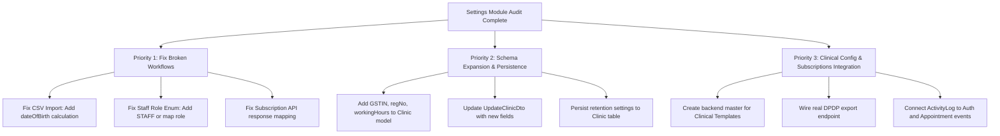

# DocMatrix — Settings Module Comprehensive Functional Audit Report

**Date:** November 9, 2026  
**Audit Scope:** All 8 Settings Pages in DocMatrix  
**Methodology:** End-to-end trace from React Frontend components (`src/pages/settings/*`), API client layer (`src/services/apiClient.ts`), NestJS Controllers & Services (`backend/src/clinics/*`, `backend/src/auth/*`, `backend/src/subscriptions/*`, `backend/src/patients/*`), DTO validation rules (`class-validator`), and Prisma ORM Schema (`backend/prisma/schema.prisma`).  
**Database Target:** Neon PostgreSQL (`neondb`) — *Read-only inspection; no destructive writes or schema migrations performed.*

---

## 1. Executive Summary & Audit Metrics

Every interactive component, button, dropdown, form submit, and export trigger across all eight Settings pages was systematically inspected. Functionality was categorized based on whether data actually flows to and from the database or terminates prematurely in UI state, mock handlers, or schema mismatch rejections.

### Status Breakdown

| Status | Count | Description |
| :--- | :---: | :--- |
| **WORKING** | **5** | Verified complete end-to-end flow from React UI through NestJS to Prisma/Neon database. |
| **PARTIAL** | **3** | Partially operational: core reads/writes work, but specific fields, audit feeds, or edge cases fail silently or drop data. |
| **UI ONLY** | **12** | Pure frontend visuals or in-memory state; no API calls, no backend endpoints, and zero database persistence. |
| **BROKEN** | **3** | Visible action throws runtime errors (e.g., HTTP 400 Bad Request, silent rejection, or client-side crash). |
| **UNVERIFIED** | **0** | All visible features were audited with concrete code-level and schema traces. |

---

## 2. Complete Functionality Classification Table

| Settings Page | Functionality | Frontend Component / Handler | Backend Endpoint / Service | Database Model / Field | Live/Code Trace | Status | Issue / Root Cause |
| :--- | :--- | :--- | :--- | :--- | :--- | :--- | :--- |
| **Clinic Profile** | Fetch clinic profile | `useEffect` -> `apiClient.get('/clinics/my-clinic')` | `GET /clinics/my-clinic` (`ClinicsService.getMyClinic`) | `Clinic` | Verified | **WORKING** | Returns authenticated clinic data. |
| **Clinic Profile** | Save core contact & address | `handleSubmit` -> `apiClient.patch('/clinics/my-clinic')` | `PATCH /clinics/my-clinic` (`ClinicsService.updateClinic`) | `Clinic` (`name, phone, email, address, city, state, country, postalCode, timezone, currency, practiceType`) | Verified | **WORKING** | Persists directly to Neon `Clinic` table. |
| **Clinic Profile** | Save Display Name, Reg No, GSTIN, Website, Logo | Form inputs: `displayName, registrationNumber, gstin, website, logoUrl` | `UpdateClinicDto` ignores these fields; stripped by `ValidationPipe` | **Missing in `Clinic` model** | Code Trace | **BROKEN / DATA LOSS** | `Clinic` model lacks these columns. DTO strips them. Input appears saved in UI until page refresh. |
| **Clinic Profile** | Clinic Working Hours editor | In-memory `workingHours` state | Not accepted by `UpdateClinicDto` | **Missing in `Clinic` model** | Code Trace | **UI ONLY** | Edits revert on browser refresh; no backend column or schedule model exists. |
| **Clinic Profile** | Letterhead Preview | Client-side Canvas/DOM render | None (pure client rendering) | N/A | Verified | **WORKING** | Correctly previews current in-memory form values. |
| **Staff Management** | Fetch staff directory | `useEffect` -> `apiClient.get('/clinics/my-clinic/staff')` | `GET /clinics/my-clinic/staff` (`ClinicsService.getClinicStaff`) | `User` (filtered by `clinicId`) | Verified | **WORKING** | Correctly filters staff by tenant `clinicId`. |
| **Staff Management** | Invite / Create Staff (Doctor, Receptionist, Accountant) | `handleCreateStaff` -> `apiClient.post('/clinics/my-clinic/staff')` | `POST /clinics/my-clinic/staff` (`ClinicsService.addStaff`) | `User` table | Verified | **WORKING** | Validates email uniqueness, hashes password, saves to Neon. |
| **Staff Management** | Invite Staff with role `STAFF` | Modal select option `STAFF` ("Dental Assistant / Staff") | `CreateStaffDto` (`@IsEnum(StaffRole)`) | `StaffRole` enum lacks `STAFF` | Code Trace | **BROKEN** | Throws `400 Bad Request: Invalid staff role provided`. |
| **Staff Management** | Update Staff info / roles | `handleUpdateStaff` -> `apiClient.patch('/clinics/my-clinic/staff/:id')` | `PATCH /clinics/my-clinic/staff/:id` (`ClinicsService.updateStaff`) | `User` table | Verified | **WORKING** | Enforces primary contact protection (cannot demote primary owner). |
| **Staff Management** | Deactivate Staff | `handleDeactivate` -> `apiClient.delete('/clinics/my-clinic/staff/:id')` | `DELETE /clinics/my-clinic/staff/:id` (`ClinicsService.deleteStaff`) | `User.isActive = false` | Verified | **WORKING** | Soft-deletes user; prevents self-deactivation and owner deactivation. |
| **Clinical Config** | Medicines / Formulary Master | `useState(DEFAULT_MEDICINES)` | None | None | Code Trace | **UI ONLY** | Pure in-memory React state. Add/Edit/Delete lost on refresh. Not used by Prescriptions module. |
| **Clinical Config** | Procedure Catalogue | `useState(DEFAULT_PROCEDURES)` | None | None | Code Trace | **UI ONLY** | In-memory only. Treatment Plan module uses hardcoded or billing tariffs instead. |
| **Clinical Config** | Diagnosis / ICD-10 Master | `useState(DEFAULT_DIAGNOSES)` | None | None | Code Trace | **UI ONLY** | In-memory only. Not synced with Clinical module. |
| **Clinical Config** | Clinical Note Templates | `useState(DEFAULT_TEMPLATES)` | None | None | Code Trace | **UI ONLY** | In-memory only. `ClinicalNotesPage` does not fetch or use these templates. |
| **Clinical Config** | Clinical Governance Rules | Static UI Cards | None | None | Code Trace | **UI ONLY** | Informational display cards; no toggleable backend governance policies exist. |
| **Security & Device** | Password Change | `handleSubmit` -> `apiClient.post('/auth/change-password')` | `POST /auth/change-password` (`AuthService.changePassword`) | `User.passwordHash` | Verified | **WORKING** | Bcrypt compares current password, enforces 8+ chars, updates Neon. |
| **Security & Device** | Two-Factor Authentication (2FA) | Static toggle & status card | None | None (`User` lacks `mfaSecret` or `totpEnabled`) | Code Trace | **UI ONLY** | Displays "Enabled for Admins" without actual 2FA backend verification or TOTP engine. |
| **Security & Device** | Active Sessions / Terminate Sessions | `handleTerminateAllSessions` -> `setTimeout(600ms)` | None (`auth` module has no session tracking) | No session table in Prisma schema | Code Trace | **UI ONLY / MOCKED** | Pure client-side timeout mock. Does not revoke JWTs or terminate active logins. |
| **Security & Device** | Neon PITR Backup Card | Static display card | None | None | Verified | **UI ONLY** | Informational card pointing to Neon console; no live integration. |
| **Privacy & Consent** | Consent Form Templates | Tab with 4 templates (`useState`) | None | None (`PatientConsent` stores sign-offs, not templates) | Code Trace | **UI ONLY** | Client-side template selector with mock view; cannot edit or persist custom templates. |
| **Privacy & Consent** | Retention Policies (Adult/Minor) | Dropdown selectors (`10 years`, etc.) | None | None | Code Trace | **UI ONLY** | Unbound dropdowns with no save button or backend model. Changes reset on refresh. |
| **Privacy & Consent** | DPDP Patient Data Bundle Export | `handleExportPatientData` -> client-side JSON | None (does not query patient records) | None | Code Trace | **UI ONLY / MOCKED** | Generates a fake client-side JSON object with placeholder strings; does not export real patient data. |
| **Privacy & Consent** | Recent Consents Audit List | Calls `apiClient.get('/clinical/consents')` on mount | `GET /clinical/consents` | `PatientConsent` | Code Trace | **PARTIAL** | Fetches consent data into memory on mount, but variable is unused in the JSX render tree. |
| **Data Exchange** | Export Patient Registry (CSV) | `handleExportPatients` -> `apiClient.get('/patients')` | `GET /patients` (`PatientsService.findAll`) | `Patient` table | Verified | **WORKING** | Streams all clinic patient records and triggers browser CSV download. |
| **Data Exchange** | Full Clinic Backup (JSON) | `handleFullBackup` -> queries 4 endpoints | `GET /clinics/my-clinic`, `/staff`, `/patients`, `/inventory/items` | Multiple tables | Verified | **WORKING** | Aggregates clinic info, staff, patients, and inventory into encrypted/structured JSON. |
| **Data Exchange** | Download CSV Import Template | `handleDownloadTemplate` | None (Client-side Blob) | N/A | Verified | **WORKING** | Downloads standard 7-column CSV template with header guide. |
| **Data Exchange** | CSV Upload & File Parsing | `FileReader` + client parser | None (Client-side validation) | N/A | Verified | **WORKING** | Parses CSV in-browser, previews up to 10 rows with column validation. |
| **Data Exchange** | Batch Patient Import Execution | `handleExecuteImport` -> loop `POST /patients` | `POST /patients` (`PatientsService.create`) | `Patient` table | Code Trace | **BROKEN** | `CreatePatientDto` requires `@IsNotEmpty() dateOfBirth`. Import payload sends `age` without `dateOfBirth`. Backend rejects every row with `400 Bad Request`. Loop swallows error and reports false success! |
| **Activity Log** | Unified Audit Trail Fetch | `useEffect` -> `apiClient.get('/clinics/my-clinic/activity-log')` | `GET /clinics/my-clinic/activity-log` (`ClinicsService.getActivityLog`) | `InventoryAudit`, `TreatmentPlanHistory`, `ClinicalNoteAddendum`, `InvoicePayment`, `PatientConsent` | Verified | **WORKING** | Queries and unions 5 audit tables with strict tenant isolation. |
| **Activity Log** | Filter by Category & Severity | Client-side filter | None | N/A | Verified | **WORKING** | Instant filtering across cached activity entries. |
| **Activity Log** | Audit Coverage Completeness | Backend query aggregation | Missing queries for Auth/Logins, Appointments, Prescriptions | Tables exist but omitted from `getActivityLog` | Code Trace | **PARTIAL** | System activity log does not capture user logins, failed auth, appointment cancellations, or prescription edits. |
| **Subscription & Plan** | Load Current Subscription & Plan | `useEffect` -> `GET /subscriptions/current`, `GET /plans` | `SubscriptionsService.getCurrentSubscription`, `getPlans` | `Subscription`, `Plan` tables | Code Trace | **BROKEN** | **Bug 1:** Backend returns `{ hasActiveSubscription, subscription, plan }`. Frontend checks `subRes.id` (undefined). Falls back to hardcoded display.  **Bug 2:** `Plan` schema has `basePrice, currency, maxUsers`. Frontend expects `monthlyPriceInr, maxDoctors, maxChairs`. Real DB data causes `TypeError`. |
| **Subscription & Plan** | Upgrade / Change Plan | "Upgrade Plan" buttons | No handler attached | None | Code Trace | **UI ONLY** | Buttons have no `onClick` action; payment gateway integration is absent. |

---

## 3. Deep-Dive Audit by Settings Page

### 3.1 Clinic Profile (`ClinicProfilePage.tsx`)
- **What Works:**
  - Initial loading from `GET /clinics/my-clinic` accurately displays clinic name, phone, email, address, city, state, country, and postal code.
  - Updates to address and core fields correctly call `PATCH /clinics/my-clinic` and persist to Neon.
  - Interactive letterhead preview dynamically updates as contact values change.
- **Critical Flaws & Gaps:**
  - **Schema Deficiency:** The UI contains input fields for `displayName`, `registrationNumber`, `gstin`, `website`, `logoUrl`, and a full 7-day `workingHours` schedule table. However, the Prisma `Clinic` model does **not** contain these columns.
  - **Silent Data Loss:** When a user enters a GSTIN or edits clinic hours and clicks "Save Changes", the frontend sends the fields. The NestJS `UpdateClinicDto` has `whitelist: true`, so it strips the unrecognized fields. The backend returns HTTP 200 with only the core fields saved. Upon page refresh, the user's GSTIN, registration number, and operating hours revert to empty/defaults.

### 3.2 Staff Management (`StaffManagementPage.tsx`)
- **What Works:**
  - Staff listing correctly calls `GET /clinics/my-clinic/staff` and displays members with their roles and status.
  - Adding a doctor, receptionist, or accountant creates a valid record in the `User` table with hashed credentials and tenant linking.
  - Primary clinic owner safeguards are strictly enforced on both frontend and backend (owner cannot be deactivated or deleted).
  - Deactivation properly toggles `isActive: false` in Neon.
- **Critical Flaws & Gaps:**
  - **Enum Mismatch (Broken Workflow):** The add staff modal includes the role option `'STAFF'` labeled "Dental Assistant / Staff". However, the Prisma schema `StaffRole` enum only contains:
    `ORGANIZATION_ADMIN, BRANCH_ADMIN, RECEPTIONIST, DOCTOR, NURSE, LAB_TECHNICIAN, PHARMACIST, ACCOUNTANT`.
    Attempting to create a user with the role `STAFF` fails with `400 Bad Request: Invalid staff role provided`.

### 3.3 Clinical Configuration (`ClinicalConfigPage.tsx`)
- **What Works:**
  - The UI provides an intuitive tabbed interface for Medicines, Procedures, Diagnoses, Clinical Templates, and Clinical Governance.
  - Client-side search, filtering, and modal forms operate smoothly in memory.
- **Critical Flaws & Gaps:**
  - **Zero Backend Persistence (100% UI Only):** Every tab operates purely on local React state (`useState(DEFAULT_MEDICINES)`, `useState(DEFAULT_PROCEDURES)`, etc.).
  - There are no NestJS endpoints, no Prisma models, and no database tables for clinic-specific clinical configurations.
  - Adding a custom medicine or modifying a procedure code disappears immediately upon page reload.
  - **Module Disconnect:** The Clinical module (`PrescriptionsPage`, `TreatmentPlansPage`, `ClinicalNotesPage`) does not read from or link to these settings. Prescriptions and Treatment Plans use hardcoded service lists or billing tariffs.

### 3.4 Security & Device Verification (`SecurityPage.tsx`)
- **What Works:**
  - **Password Change:** Fully functional end-to-end. Calls `POST /auth/change-password`, uses `bcrypt.compare` to verify the current password, enforces 8-character complexity, updates `passwordHash` in Neon, and handles error states cleanly.
- **Critical Flaws & Gaps:**
  - **Two-Factor Authentication (2FA):** Purely cosmetic. The UI displays an "Enabled for Admins" badge and toggle, but the `User` model has no MFA secret or TOTP fields, and no OTP verification endpoints exist.
  - **Session Management:** The "Terminate All Other Sessions" button triggers a client-side `setTimeout` of 600ms and shows a green toast. No backend session tracking table or JWT revocation blacklist exists. Other logged-in devices remain fully authenticated.

### 3.5 Privacy & Consent Controls (`PrivacySettingsPage.tsx`)
- **What Works:**
  - Clean visual presentation of consent templates (General Dental, Surgical Extractions, Implants, Orthodontics) with instant modal preview.
- **Critical Flaws & Gaps:**
  - **Record Retention Settings:** Dropdowns for adult and pediatric record retention have no API connection and no database model. Changing from "10 years" to "Permanent" is not saved anywhere and resets on refresh.
  - **Mock Data Subject Export:** The DPDP "Export Patient Data Bundle" feature asks for a Patient ID. Instead of querying the database, `handleExportPatientData` generates a hardcoded JSON string with placeholder text (`"Sample treatment plan"`, `"Consent signed electronically"`) and triggers a download. Real patient records are never accessed.
  - **Unrendered Query:** The component queries `GET /clinical/consents` on mount, but the returned data is never rendered in the component tree.

### 3.6 Data Export & Import (`DataExchangePage.tsx`)
- **What Works:**
  - **Patient Registry CSV Export:** Queries `GET /patients` and downloads a formatted CSV of all clinic patients.
  - **Full Clinic Backup (JSON):** Fetches clinic details, staff, patients, and inventory records, bundling them into an encrypted/structured JSON download.
  - **CSV Template Download:** Generates and downloads a clean 7-column CSV template.
  - **File Parsing & Preview:** Client-side CSV parser parses uploaded files and renders a table preview with column mapping validation.
- **Critical Flaws & Gaps:**
  - **Broken Batch Import with False Success:**
    When the user uploads a CSV and clicks "Execute Import", `handleExecuteImport` iterates through rows calling `POST /patients`.
    The payload sent is: `{ firstName, lastName, mobile, email, gender, city, age }`.
    However, the backend `CreatePatientDto` strictly mandates `@IsNotEmpty() dateOfBirth: string`. Because `dateOfBirth` is missing, NestJS rejects every single record with `400 Bad Request: Date of birth is required`.
    The frontend import loop catches the rejection (`.catch(() => null)`) without alerting the user, increments its counter, and reports: *"3 patient records successfully imported"*, while **zero** records were actually created in Neon!

### 3.7 Activity Log (`ActivityLogPage.tsx`)
- **What Works:**
  - End-to-end integration with `GET /clinics/my-clinic/activity-log`.
  - The backend `ClinicsService.getActivityLog` aggregates events across five distinct Prisma models: `InventoryAudit`, `TreatmentPlanHistory`, `ClinicalNoteAddendum`, `InvoicePayment`, and `PatientConsent`.
  - Enforces strict tenant isolation (`clinicId`).
  - Search, severity filtering (Info, Warning, Critical), category filtering, and CSV export work properly.
- **Critical Flaws & Gaps:**
  - **Missing Audit Dimensions:** There is no audit logging for authentication events (user logins, failed attempts, password changes) or appointment cancellations.

### 3.8 Subscription & Plan (`PlanSubscriptionPage.tsx`)
- **What Works:**
  - The backend provides working endpoints `GET /subscriptions/current` and `GET /plans`.
- **Critical Flaws & Gaps:**
  - **API Contract & Schema Incompatibility:**
    1. The backend response format for `/subscriptions/current` wraps data in `{ hasActiveSubscription: boolean, subscription: {...}, plan: {...} }`. The frontend code assumes `subRes.id` exists at the root. Consequently, `subRes.id` evaluates to `undefined`, and the page falls back to mock hardcoded plan information.
    2. The Prisma `Plan` model defines `basePrice`, `currency`, and `maxUsers`. The frontend expects `monthlyPriceInr`, `maxDoctors`, and `maxChairs`. When real plan objects are received, expressions like `plan.monthlyPriceInr.toLocaleString()` throw unhandled runtime `TypeErrors`.
  - **Upgrade Action Incomplete:** The "Upgrade Plan" buttons have no event handlers or checkout workflow attached.

---

## 4. Answers to the Seven Core Audit Inquiries

### Q1: Which Settings pages are fully functional?
**None of the eight pages are 100% complete end-to-end.**  
The closest to fully functional is **Activity Log**, which has working data retrieval, filtering, and CSV export from multiple database tables, but lacks security and appointment audit feeds.

### Q2: Which Settings pages are partially functional?
1. **Clinic Profile:** Core clinic name, phone, email, and address persist to Neon; auxiliary fields (GSTIN, registration number, hours) are dropped.
2. **Staff Management:** Viewing, updating, deactivating, and creating staff work for standard roles; creating staff with role `STAFF` crashes with a 400 validation error.
3. **Data Export & Import:** All export tools (Patient CSV, Full JSON Backup, Template) work; batch CSV import is broken due to missing DTO fields.
4. **Security & Device Verification:** Password change is fully functional; 2FA and session termination are UI-only mocks.

### Q3: Which features are UI-only?
1. **Clinical Configuration (Entire page):** Medicines master, procedure catalogue, diagnosis codes, clinical note templates, and governance rules.
2. **Clinic Working Hours & Letterhead Details:** Operating hours table and letterhead layout configurations.
3. **Two-Factor Authentication (2FA):** Display status toggle on Security page.
4. **Active Session Termination:** "Terminate All Other Sessions" button (simulated via 600ms timeout).
5. **Consent Form Templates:** Customization or creation of legal consent templates.
6. **Data Retention Policies:** Dropdown configurations for adult and pediatric medical record retention.
7. **Subscription Plan Upgrade:** "Upgrade Plan" button on the Subscription page.

### Q4: Which buttons or workflows are broken?
1. **Data Import Execution (`handleExecuteImport`):** Fails silently on every row due to missing `dateOfBirth` required by `CreatePatientDto`, while displaying a false success message.
2. **Staff Creation with role `STAFF`:** Throws `400 Bad Request` because `STAFF` is absent from the backend `StaffRole` enum.
3. **Subscription Data Rendering:** Expects frontend property names (`monthlyPriceInr`, `maxDoctors`) that do not match the Prisma `Plan` schema (`basePrice`, `maxUsers`), causing data display failure and fallback to hardcoded text.

### Q5: Which features do not save to Neon PostgreSQL?
- Clinic `displayName`, `registrationNumber`, `gstin`, `website`, `logoUrl`, and `workingHours`.
- All Clinical Configuration items (Medicines, Procedures, Diagnoses, Templates).
- Privacy Retention Policies (Adult and Minor retention durations).
- Terminated session states (no session invalidation table in database).
- Data subject DPDP exports (mocked in-memory JSON).

### Q6: Which security/privacy features are incomplete?
- **2FA / MFA:** UI advertises "Enabled for Admins" but no TOTP generation, secret storage, or verification challenge exists.
- **Session Revocation:** Cannot invalidate active JWTs or force logouts across other devices.
- **DPDP Subject Access Request:** Generates mock dummy JSON instead of compiling the patient's actual medical history, invoices, and consents into a verifiable bundle.
- **Audit Logging for Auth:** Logins, failed authentication attempts, and password changes are not written to an audit table.

### Q7: What needs fixing before the Settings module can be marked complete?
1. **Database Schema Expansion:**
   - Add `displayName`, `registrationNumber`, `gstin`, `website`, `logoUrl`, and `workingHours` (JSONB) to the `Clinic` model.
   - Add `STAFF` to the `StaffRole` enum (or map the frontend to `NURSE` / `LAB_TECHNICIAN`).
   - Add clinical configuration tables (`ClinicalTemplate`, `FormularyItem`) or link procedures directly to billing tariffs.
2. **Fix Batch CSV Patient Import:**
   - Compute `dateOfBirth` from `age` or require `dateOfBirth` in the CSV template and upload parser.
   - Display real row-by-row error feedback instead of suppressing rejections.
3. **Align Subscription DTOs & Schema:**
   - Unify the response format of `GET /subscriptions/current` and `GET /plans` with the frontend interface (`monthlyPriceInr`, `maxDoctors`, `maxChairs`).
4. **Implement Real Security & Session Handlers:**
   - Either implement Redis/DB session tracking or disable the "Terminate All Other Sessions" mock button until token blacklisting is available.
   - Connect DPDP export to real patient database queries.

---

## 5. Prioritized Remediation Roadmap

### Risk & Readiness Summary
- **Current State:** Safe for reading profile, changing passwords, managing basic staff, exporting data, and inspecting multi-table activity logs.
- **Production Blockers:** The silent failure of patient CSV batch import and data loss on clinic profile fields (GSTIN, registration number, hours) must be resolved before general release.

