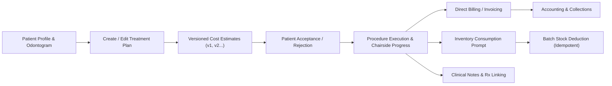

# DocMatrix — Treatment Plans Final Implementation & Integration Report

**Date:** November 10, 2026  
**Status:** COMPLETED & VERIFIED  
**Repository Branch:** `test/merge-master-with-billing`  
**Target Environments:** React 18 Frontend + NestJS Backend + Prisma ORM + Neon PostgreSQL

---

## 1. Executive Summary

The DocMatrix **Treatment Plans & Integrated Cost Estimates** module has reached complete end-to-end operational integration. Following the successful completion of Phase 1 (Invoice generation from plan procedures, treating dentist assignment, and transactional inventory deduction deduplication), the remaining gaps (Phases 2 through 8) have been implemented, tested, and verified.

The module now functions as a unified clinical, operational, and financial workflow engine connecting **Patient Profiles**, **Clinical Notes**, **Digital Prescriptions**, **Interactive Odontogram (FDI Tooth Chart)**, **Billing Tariffs & Invoices**, and **Inventory Deductions**.

---

## 2. Completed Functional Deliverables

### Phase 1 — Billing Integration, Treating Dentist, & Inventory Idempotency (Previously Verified)
- **Direct Invoice Generation:** `data-testid="bill-treatment-plan-btn"` in [TreatmentPlanDetailsModal.tsx](file:///c:/Users/user/Documents/White Matrix Files/doc matrix/Doc_matrix-main/Doc_matrix-main/src/components/clinical/TreatmentPlanDetailsModal.tsx) allows selective billing of unbilled procedures via `billingApi.createInvoiceFromTreatmentPlan()`.
- **Treating Dentist Assignment:** Dropdown dynamically populated with eligible clinical practitioners (`DOCTOR`, `DENTIST`, `ORGANIZATION_ADMIN`, `BRANCH_ADMIN`), defaulting to active session practitioner.
- **Inventory Idempotency:** Added unique audit constraints and `operationId` in [ConfirmDeductionDto](file:///c:/Users/user/Documents/White Matrix Files/doc matrix/Doc_matrix-main/Doc_matrix-main/backend/src/inventory/dto/confirm-deduction.dto.ts) with zero-stock clamping (`Math.max(0, currentStock - qty)`).

### Phase 2 — Treatment Plan Editing and Lifecycle
1. **Edit Treatment Plan Workflow:**
   - Added `data-testid="edit-treatment-plan-btn"` in `TreatmentPlanDetailsModal.tsx` enabled for active plans (non-completed and non-cancelled).
   - [TreatmentPlanModal.tsx](file:///c:/Users/user/Documents/White Matrix Files/doc matrix/Doc_matrix-main/Doc_matrix-main/src/components/clinical/TreatmentPlanModal.tsx) accepts `planToEdit?: TreatmentPlanRecord`.
   - Pre-fills patient, treating doctor, title, notes, tax rate, and existing clinical stages/items.
   - **Protection of Billed/Completed Items:** Procedures that have already been billed (`billedItemMap.has(item.id)`) or marked `COMPLETED` have their financial and clinical inputs locked (`disabled`) with visual green `Billed` or `Completed` badges to protect legal accounting records.
   - Added **Revision Reason** input field (`revisionReason`), defaulting to `Estimate revision v{currentVersion + 1} - clinical adjustments`.
   - On submission, calls `updateStructuredTreatmentPlan` in [clinicStore.ts](file:///c:/Users/user/Documents/White Matrix Files/doc matrix/Doc_matrix-main/Doc_matrix-main/src/services/clinicStore.ts) and backend `PATCH /treatment-plans/:id`.
2. **Estimate Versioning & Automatic Re-Acceptance:**
   - Revisions increment `currentVersion` (e.g. v1 &rarr; v2).
   - Generates an immutable snapshot in `TreatmentEstimateRevision` with `itemsSnapshot`, `subtotal`, `tax`, `discount`, and `totalEstimatedCost`.
   - If plan was previously `ACCEPTED` and undergoes revision, the status resets to `PROPOSED` so that renewed chairside or written patient consent can be collected.
3. **Plan & Procedure Cancellation:**
   - Added `data-testid="cancel-treatment-plan-btn"` and confirmation modal requiring a mandatory cancellation reason.
   - Status transitions to `CANCELLED` via `updateTreatmentPlanStatus(id, 'Cancelled', reason)` and backend `PATCH /treatment-plans/:id/status`.
   - Cancellation audit event recorded in `TreatmentPlanHistory`.
   - Invoices and completed procedure items remain safely preserved.
   - Procedure-level status dropdown allows marking individual procedures as `CANCELLED`.
   - Added `Cancelled` filter chip in [TreatmentPlansPage.tsx](file:///c:/Users/user/Documents/White Matrix Files/doc matrix/Doc_matrix-main/Doc_matrix-main/src/pages/clinical/TreatmentPlansPage.tsx) with live count.

### Phase 3 — Clinical Configuration & Interactive Odontogram
1. **Dynamic Procedure Catalog & Tariffs:**
   - Imported `useBillingData` from `billingStore.ts`.
   - Procedure dropdown in `TreatmentPlanModal.tsx` displays structured `<optgroup>` groupings:
     - `Standard Dental Procedures (CDT / ADA)`
     - `Clinic Service Tariffs` (configured via Settings > Clinical Config or Billing Tariffs)
   - Custom procedure entry with custom fees and categories remains fully supported.
2. **Interactive Odontogram (Tooth Chart):**
   - Embedded [ToothChart.tsx](file:///c:/Users/user/Documents/White Matrix Files/doc matrix/Doc_matrix-main/Doc_matrix-main/src/pages/patients/ToothChart.tsx) into `TreatmentPlanModal.tsx` with a collapsible drawer/toggle button.
   - Clicking any tooth in the Maxillary (Upper) or Mandibular (Lower) arch dynamically populates/toggles the FDI tooth number for the active procedure row.
   - Includes quick-toggle dentition mode buttons (`Adult (32)` vs `Primary (20)`).
   - Dental surface pills (M, O, D, B, L, I) allow instant multi-surface specification (e.g. MO, MOD, B).

### Phase 4 — Clinical Module Integration
1. **Clinical Notes Linking:**
   - Added **Clinical Notes & Rx** tab in `TreatmentPlanDetailsModal.tsx`.
   - Renders patient examination notes with chief complaint, diagnosis, and treatment performed.
2. **Digital Prescriptions Linking:**
   - Displays all associated prescriptions for the patient with medication names, dosages, frequencies, and prescribing dentist.
3. **Audit History & Timeline:**
   - Added **Audit Timeline** tab in `TreatmentPlanDetailsModal.tsx`.
   - Chronologically renders all plan events: `CREATED`, `ESTIMATE_REVISED` (v1, v2...), `ACCEPTED` (with verbal vs written flag), `INVOICED` (with invoice number), `STATUS_CHANGED`, and `CANCELLED`.

### Phase 5 — Billing & Inventory Completion
1. **Financial Breakdown Strip:**
   - Added a prominent top summary banner in `TreatmentPlanDetailsModal.tsx` showing:
     - **Total Estimated Cost:** Authoritative estimate.
     - **Invoiced to Date:** Sum of billed procedures.
     - **Unbilled Balance:** Outstanding unbilled treatment amount.
     - **Billing Status Badge:** `Unbilled` | `Partially Billed` | `Fully Billed`.
2. **Material Usage Auto-Prompt on Completion:**
   - When any procedure status is changed to `COMPLETED`, a prompt card appears:
     *"Procedure '[Name]' marked as Completed. Record material consumption now?"*
   - Clicking `Record Material Usage` directly opens [TreatmentMaterialUsageModal.tsx](file:///c:/Users/user/Documents/White Matrix Files/doc matrix/Doc_matrix-main/Doc_matrix-main/src/components/inventory/TreatmentMaterialUsageModal.tsx) with pre-filled patient, procedure, and doctor IDs.
   - Leverages Phase 1 idempotency (`operationId`) to prevent duplicate stock subtractions.

### Phase 6 — UI / UX & Dark Mode
- Full dark mode support using CSS variables (`--tp-teal`, `--tp-proposed`, `--tp-accepted`, `--tp-cancelled`, `--surface`, `--text-main`, `--line`).
- High-contrast badges for all statuses: Proposed, Accepted, In Progress, Completed, Deferred, Cancelled, and Billed.
- Fully responsive table and modal layout accommodating tablet and desktop viewports.

---

## 3. Architecture & File Registry

| File Path | Role & Changes |
|---|---|
| [backend/src/treatment-plans/dto/update-treatment-plan.dto.ts](file:///c:/Users/user/Documents/White Matrix Files/doc matrix/Doc_matrix-main/Doc_matrix-main/backend/src/treatment-plans/dto/update-treatment-plan.dto.ts) | Added `doctorId?: string` to support practitioner reassignment during plan edits. |
| [backend/src/treatment-plans/treatment-plans.service.ts](file:///c:/Users/user/Documents/White Matrix Files/doc matrix/Doc_matrix-main/Doc_matrix-main/backend/src/treatment-plans/treatment-plans.service.ts) | Updated `updateTreatmentPlan` to handle doctor reassignment, snapshot creation, and version transitions. |
| [src/services/clinicStore.ts](file:///c:/Users/user/Documents/White Matrix Files/doc matrix/Doc_matrix-main/Doc_matrix-main/src/services/clinicStore.ts) | Added `updateStructuredTreatmentPlan`, preserved item statuses during plan creation/edit. |
| [src/components/clinical/TreatmentPlanModal.tsx](file:///c:/Users/user/Documents/White Matrix Files/doc matrix/Doc_matrix-main/Doc_matrix-main/src/components/clinical/TreatmentPlanModal.tsx) | Added `planToEdit` support, locking for completed/billed items, revision changelog, interactive FDI Odontogram, and tariffs catalog. |
| [src/components/clinical/TreatmentPlanDetailsModal.tsx](file:///c:/Users/user/Documents/White Matrix Files/doc matrix/Doc_matrix-main/Doc_matrix-main/src/components/clinical/TreatmentPlanDetailsModal.tsx) | Added Edit Plan trigger, Cancel Plan modal, Billing Summary Strip, Material Usage Auto-Prompt, and Clinical Notes & Rx tab. |
| [src/pages/clinical/TreatmentPlansPage.tsx](file:///c:/Users/user/Documents/White Matrix Files/doc matrix/Doc_matrix-main/Doc_matrix-main/src/pages/clinical/TreatmentPlansPage.tsx) | Added `Cancelled` filter chip and count tracking. |
| [src/pages/clinical/treatmentPlans.css](file:///c:/Users/user/Documents/White Matrix Files/doc matrix/Doc_matrix-main/Doc_matrix-main/src/pages/clinical/treatmentPlans.css) | Added `--tp-cancelled` variables and `.tp-status-cancelled` styling for light and dark themes. |
| [tests/treatmentPlansPhase2To6Integration.test.jsx](file:///c:/Users/user/Documents/White Matrix Files/doc matrix/Doc_matrix-main/Doc_matrix-main/tests/treatmentPlansPhase2To6Integration.test.jsx) | Comprehensive 10-test test suite verifying all Phase 2-6 capabilities. |
