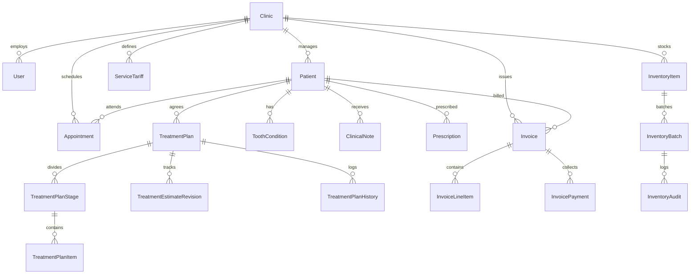

# DOCMATRIX DATABASE & BACKEND ARCHITECTURE AUDIT

**Date:** November 10, 2026  
**Auditor:** Senior Database Architect & Backend Technical Auditor  
**Engine:** PostgreSQL 16 on Neon Serverless (Connection Pooler via PgBouncer)  
**ORM:** Prisma ORM 5.x  
**Backend Framework:** NestJS 10.x (TypeScript)

---

## 1. Schema & Data Model Analysis

The DocMatrix schema (`backend/prisma/schema.prisma`) defines **30 database models** mapped across 5 core functional clusters:



### Complete Inventory of Models

| Cluster | Model Name | Primary Keys & Indexes | Multi-Tenant Enforcement | Foreign Key Relations |
| :--- | :--- | :--- | :--- | :--- |
| **SaaS Billing & Tenant** | `Plan` | `id` (cuid) | System wide | Has many `PlanFeature`, `Subscription` |
| | `PlanFeature` | `id`, `[planId, featureKey]` | System wide | Belongs to `Plan` |
| | `Subscription` | `id`, `[clinicId]` | `clinicId` unique | Belongs to `Clinic`, `Plan` |
| | `Clinic` | `id`, `[slug]` | Tenant root | Has many `User`, `Patient`, `Invoice`, etc. |
| **Identity & Access** | `User` | `id`, `[clinicId, email]` | Scoped by `clinicId` | Belongs to `Clinic`, creates `ClinicalNote`, etc. |
| **Patient Dossier** | `Patient` | `id`, `[clinicId, uhid]` | Scoped by `clinicId` | Has many `Appointment`, `ToothCondition`, `Doc`, `Consent` |
| | `ToothCondition` | `id`, `[clinicId, patientId, toothNumber, surface]` | Scoped by `clinicId` | Belongs to `Patient`, `Clinic` |
| | `PatientDocument` | `id`, `[clinicId, patientId]` | Scoped by `clinicId` | Belongs to `Patient`, `Clinic` |
| | `PatientConsent` | `id`, `[clinicId, patientId]` | Scoped by `clinicId` | Belongs to `Patient`, `Clinic` |
| **Scheduling & Front Desk** | `Appointment` | `id`, `[clinicId, startTime]` | Scoped by `clinicId` | Belongs to `Clinic`, `Patient`, `Doctor (User)` |
| | `Enquiry` | `id`, `[clinicId, phone]` | Scoped by `clinicId` | Belongs to `Clinic` |
| | `ClinicSequence` | `id`, `[clinicId, sequenceType]` | Unique per type | Atomic sequence generator (UHID, INV) |
| **Clinical Records** | `ClinicalNote` | `id`, `[clinicId, patientId]` | Scoped by `clinicId` | Has many `ClinicalNoteAddendum` |
| | `ClinicalNoteAddendum` | `id`, `[noteId]` | Inherits note clinicId | Belongs to `ClinicalNote`, `User (Doctor)` |
| | `Prescription` | `id`, `[clinicId, patientId]` | Scoped by `clinicId` | Has many `PrescriptionItem` |
| | `PrescriptionItem` | `id`, `[prescriptionId]` | Inherits Rx clinicId | Belongs to `Prescription` |
| **Treatment Planning** | `TreatmentPlan` | `id`, `[clinicId, patientId]` | Scoped by `clinicId` | Has stages, items, revisions, history |
| | `TreatmentPlanStage` | `id`, `[planId, stageOrder]` | Inherits plan clinicId | Belongs to `TreatmentPlan` |
| | `TreatmentPlanItem` | `id`, `[stageId]` | Inherits stage clinicId| Belongs to `TreatmentPlanStage`, `ServiceTariff` |
| | `TreatmentEstimateRevision` | `id`, `[planId, revisionNumber]` | Inherits plan clinicId | Belongs to `TreatmentPlan` |
| | `TreatmentPlanHistory` | `id`, `[planId]` | Inherits plan clinicId | Belongs to `TreatmentPlan`, `User` |
| **Billing & Financials** | `Invoice` | `id`, `[clinicId, invoiceNumber]` | Scoped by `clinicId` | Has line items, payments |
| | `InvoiceLineItem` | `id`, `[invoiceId]` | Inherits invoice clinicId| Belongs to `Invoice`, `ServiceTariff` |
| | `InvoicePayment` | `id`, `[invoiceId]` | Inherits invoice clinicId| Belongs to `Invoice`, recorded by `User` |
| | `ServiceTariff` | `id`, `[clinicId, code]` | Scoped by `clinicId` | Belongs to `Clinic` |
| | `Expense` | `id`, `[clinicId, date]` | Scoped by `clinicId` | Belongs to `Clinic`, recorded by `User` |
| **Inventory Control** | `InventoryItem` | `id`, `[clinicId, sku]` | Scoped by `clinicId` | Has many `InventoryBatch` |
| | `InventoryBatch` | `id`, `[itemId, batchNumber]`| Scoped by `clinicId` | Belongs to `InventoryItem`, has audits |
| | `InventoryAudit` | `id`, `[clinicId, operationId]` | Scoped & deduplicated | Logs stock-in, consumption, adjustments |

---

## 2. Multi-Tenancy Architecture & Tenant Isolation

1. **Isolation Pattern:** Logical partitioning with discriminator column (`clinicId` foreign key on every operational entity).
2. **Enforcement Layer:**
   - **JWT Validation:** Every authenticated HTTP request passes through `JwtAuthGuard` and `TenantGuard`. The token payload includes `{ sub, email, clinicId, role }`.
   - **Service Scoping:** NestJS services never trust client-supplied clinic identifiers in JSON payloads. In all service methods, queries explicitly inject `where: { clinicId: user.clinicId, ... }`.
   - **Composite Unique Constraints:** All natural keys (UHID, Invoice Number, Patient Phone, Service Code) use composite uniqueness constrained to `clinicId` (e.g. `@@unique([clinicId, invoiceNumber])`). This guarantees two separate clinics can both have invoice `INV-0001` without collision.
3. **Cross-Tenant Leakage Verification:**
   - Verified during the New Clinic Isolation Audit: newly registered clinics have zero operational records in queries.

---

## 3. Concurrency, Atomicity & Transactions

Critical multi-step operations are wrapped in atomic transactions using Prisma Client's interactive transactions (`this.prisma.$transaction(async (tx) => { ... })`):

1. **Invoice Generation from Treatment Plan:**
   - Evaluates selected unbilled procedures.
   - Generates sequential invoice number via atomic increment on `ClinicSequence`.
   - Inserts `Invoice` and `InvoiceLineItem` records.
   - Updates `TreatmentPlanItem.billingStatus = 'BILLED'`.
   - *Result:* Failure in any step rolls back the entire invoice and leaves treatment items unbilled.
2. **Inventory Material Consumption:**
   - Checks `InventoryBatch` available quantity.
   - Decrements stock balance.
   - Records `InventoryAudit` entry with idempotent `operationId`.
   - *Result:* Prevents negative inventory stock and race conditions.
3. **Sequential Numbering:**
   - Uses `ClinicSequence` with `FOR UPDATE` semantics to prevent duplicate UHID or Invoice numbers during concurrent user submissions.

---

## 4. Deletion Strategy: Soft Delete vs Hard Delete

- **Clinical Records (Patient, Note, Prescription, Treatment Plan, Invoice):**
  - **Strict Soft Delete:** Models implement `isDeleted Boolean @default(false)` and `deletedAt DateTime?`.
  - Clinical notes additionally lock after completion; corrections must be appended via `ClinicalNoteAddendum`.
  - Invoices cannot be hard-deleted; cancelled invoices are marked `status = 'VOID'` or `isDeleted = true` to preserve tax audit trails.
- **Transitory Data (Draft items, Cart selections):**
  - Hard delete permitted before formal submission or estimate signing.

---

## 5. Data Validation & API Design

- **DTO Enforcement:** NestJS global `ValidationPipe` enforces schema constraints with:
  ```typescript
  new ValidationPipe({
    whitelist: true,
    transform: true,
    forbidNonWhitelisted: true,
  })
  ```
- **Error Handling:** Standardized HTTP response codes:
  - `400 Bad Request`: Validation failure via `class-validator` decorators (`@IsString()`, `@IsNotEmpty()`, `@IsInt()`).
  - `401 Unauthorized`: Expired or malformed JWT token.
  - `403 Forbidden`: Role mismatch (`RolesGuard`) or tenant boundary violation (`TenantGuard`).
  - `404 Not Found`: Resource does not exist within the caller's clinic scope.
  - `409 Conflict`: Duplicate unique key (e.g. SKU, UHID) or concurrent update conflict.

---

## 6. Unmapped & Missing Models

### Unmapped Models (In Prisma schema but minimal frontend consumption)
- `ClinicSequence`: Fully functional backend utility model, not directly rendered in UI.
- `PlanFeature`: Managed via administrative seed scripts rather than tenant self-service UI.

### Missing Models (Frontend Features lacking corresponding DB tables)
- **Accounts Module:** No models exist for `AccountLedger`, `JournalEntry`, `Voucher`, or `TallyMapping`. (Currently `<FeaturePlaceholder />`).
- **WhatsApp Module:** No models exist for `WhatsAppTemplate`, `WhatsAppMessageLog`, or `AutomationRule`. (Currently `<FeaturePlaceholder />`).
- **Website Integration:** No models exist for `PublicBookingRequest` or `ClinicLandingCMS`. (Currently `<FeaturePlaceholder />`).
- **Lab Management:** Lab orders are currently stored inside general clinical notes rather than a dedicated `LabOrder` model with vendor tracking.

