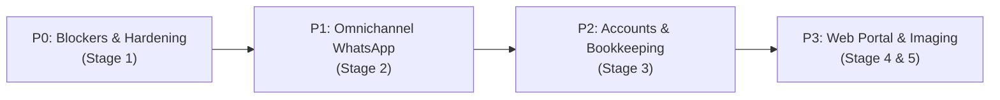

# DOCMATRIX DEVELOPMENT ROADMAP & BACKLOG

**Date:** November 10, 2026  
**Auditor:** Senior SaaS Product Analyst & Software Architect  
**Horizon:** Q4 2026 – Q2 2027  
**Strategic Focus:** Transition from Core Clinical PMS to Full Omnichannel Dental Operating System

---

## 1. Prioritized Development Backlog

### P0 — Critical Release Blockers (Pre-Production / Pilot Essentials)
1. **Server-Side Reports Aggregation:** Migrate frontend `reportMetrics.ts` calculations to dedicated NestJS `/reports/*` SQL endpoints.
2. **Cloud Document Storage:** Replace local base64/file upload with AWS S3 / Cloudflare R2 pre-signed URLs for patient attachments and consent PDFs.
3. **Automated Playwright E2E Suite:** Implement browser tests covering full patient registration -> odontogram -> treatment plan -> invoice -> payment.
4. **Neon Connection Pooling Hardening:** Configure PgBouncer transaction pooling timeouts and verify zero leakages under load.

### P1 — High Priority (Commercial Beta Launch)
1. **WhatsApp Messaging & Reminders:** Automated 24h/2h appointment reminders, recall notifications, and invoice PDF dispatch via Meta Cloud API.
2. **Refunds & Credit Notes:** Formal credit note model and partial refund workflow in Billing.
3. **Lab Orders Module:** Standalone lab vendor master, order creation, impression tracking, and delivery dates.

### P2 — Medium Priority (General Availability / GA)
1. **Accounts & Bookkeeping Module:** General ledger, Day Book, Cash/Bank registers, Profit & Loss statement.
2. **Tally XML Integration:** One-click export of sales invoices, receipts, and expenses into Tally ERP / Tally Prime format.
3. **Public Online Booking:** Embeddable booking widget for clinic websites with real-time slot checking.

### P3 — Low Priority & Future Enhancements
1. **Periodontal Charting:** 6-point pocket depth, bleeding on probing, furcation, and gingival margin charting.
2. **DICOM / Dental Imaging Viewer:** In-browser viewer for RVG, OPG, and CBCT scans.
3. **Multi-Branch Enterprise Suite:** Centralized headquarters dashboard, inter-branch stock transfers, and floating doctor schedules.

---

## 2. Phased Development Plan (Stages 1 – 6)

---

### STAGE 1: Stabilization, Hardening & Staging Readiness
- **Duration:** 10–12 Person-Days (1 Sprint)
- **Primary Objectives:** Eliminate memory bottlenecks, secure document uploads, and harden database connections before onboarding live clinics.
- **Specific Technical Deliverables:**
  - Create `backend/src/reports/` with Prisma raw/aggregate queries for daily collections, doctor procedure counts, and treatment categories.
  - Implement `DocumentsService` with S3/R2 pre-signed PUT/GET endpoints and MIME-type validation.
  - Set up Playwright runner for smoke testing the 4 primary clinical workflows.
  - Audit database indexes: Ensure composite index on `[clinicId, createdAt]` across all operational tables.
- **Acceptance Criteria:**
  - Reports load in <300ms regardless of clinic invoice count.
  - Patient documents upload directly to cloud storage.
  - 100% of Playwright E2E tests pass headlessly in CI.

---

### STAGE 2: WhatsApp Automation Engine
- **Duration:** 15–18 Person-Days (1.5 Sprints)
- **Primary Objectives:** Build omnichannel messaging automation to eliminate appointment no-shows and automate recalls.
- **Prerequisites:** Meta WhatsApp Business Account (WABA) or Twilio BSP credentials; Redis instance for background queues.
- **Specific Technical Deliverables:**
  - Backend: Add `@nestjs/bull` and Redis for delayed job scheduling.
  - Prisma Models: Add `WhatsAppConfig`, `WhatsAppTemplate`, `WhatsAppMessageLog`.
  - Automation Triggers:
    - On appointment created -> schedule 24-hour reminder job and 2-hour reminder job.
    - On invoice finalized -> send instant WhatsApp message with secure PDF download link.
    - Periodic cron -> scan for patients with completed treatments > 6 months ago for dental recall.
  - Frontend: Replace `/whatsapp/*` placeholders with template management and delivery logs UI.
- **Acceptance Criteria:**
  - Automated WhatsApp message delivered when an appointment is booked.
  - Delivery and read receipts tracked in `WhatsAppMessageLog`.

---

### STAGE 3: Accounts Module & Financial Accounting
- **Duration:** 18–20 Person-Days (2 Sprints)
- **Primary Objectives:** Provide dental practice owners with complete chartered financial bookkeeping and seamless Tally export.
- **Prerequisites:** Stage 1 completion (solid billing data model).
- **Specific Technical Deliverables:**
  - Prisma Models: Add `Account`, `JournalEntry`, `JournalPosting`, `FinancialPeriod`.
  - Double-Entry Engine:
    - Every invoice auto-posts: Debit Patient Receivable, Credit Dental Service Revenue.
    - Every payment auto-posts: Debit Cash/Bank/UPI, Credit Patient Receivable.
    - Every expense auto-posts: Debit Expense Account, Credit Cash/Bank.
  - Reporting Views: Day Book register, Trial Balance, Profit & Loss statement.
  - Tally Bridge: XML generation endpoint producing Tally-compliant `<ENVELOPE>` format for one-click import into Tally Prime.
  - Frontend: Replace `/accounts/*` placeholders with production accounting views.
- **Acceptance Criteria:**
  - Day Book matches physical daily cash/bank tally.
  - Exported XML successfully imports into Tally without parsing errors.

---

### STAGE 4: Website Integration & Patient Self-Service Portal
- **Duration:** 12–14 Person-Days (1 Sprint)
- **Primary Objectives:** Enable clinics to capture appointments directly from their website and provide patients a digital record portal.
- **Prerequisites:** Public unauthenticated API rate-limiting configured via `@nestjs/throttler`.
- **Specific Technical Deliverables:**
  - Embeddable JavaScript / iframe widget for external clinic websites.
  - Public API: `GET /public/clinics/:slug/available-slots` and `POST /public/clinics/:slug/book-appointment`.
  - Triage Queue: External bookings land in `/appointments/enquiries` or `/appointments/queue` as "Web Requested" for front-desk approval.
  - Patient Portal: Lightweight OTP-verified login allowing patients to view prescriptions and unpaid invoices.
- **Acceptance Criteria:**
  - External website visitor can book an appointment slot without clinic staff manual entry.

---

### STAGE 5: Advanced Clinical & Imaging (DICOM/X-Ray)
- **Duration:** 15–18 Person-Days (1.5 Sprints)
- **Primary Objectives:** Elevate DocMatrix to a specialized dental diagnostic suite.
- **Specific Technical Deliverables:**
  - Integrated Cornerstone.js or OHIF viewer for intra-oral X-rays (RVG) and panoramic scans (OPG).
  - Diagnostic tools: Contrast adjustment, brightness, digital measuring ruler (for endodontic working length).
  - Advanced Periodontal Charting: 6-point pocket depth grid with visual gingival margins and tooth mobility grading.
- **Acceptance Criteria:**
  - Dentists can view and measure RVG scans directly inside the patient profile without opening third-party desktop software.

---

### STAGE 6: Enterprise Multi-Branch & Chain Management
- **Duration:** 20 Person-Days (2 Sprints)
- **Primary Objectives:** Support dental hospital chains and franchises with multiple clinic locations.
- **Specific Technical Deliverables:**
  - Headquarters Tenant hierarchy: Organization -> multiple `Clinic` branches.
  - Inter-branch inventory stock transfers (Stock Transfer Note / Goods In Transit).
  - Consolidated executive dashboard with cross-branch revenue comparison and doctor roster.
  - Centralized patient lookup: Search a patient across all chain branches with permission-based record sharing.
- **Acceptance Criteria:**
  - Organization owner can switch branches seamlessly or view consolidated chain KPIs.

---

## 3. Total Effort & Timeline Overview

| Stage | Milestone Description | Duration | Target Delivery |
| :--- | :--- | :--- | :--- |
| **Stage 1** | Stabilization, Hardening & Staging Readiness | 10–12 Days | Week 1–2 |
| **Stage 2** | WhatsApp Automation Engine | 15–18 Days | Week 3–5 |
| **Stage 3** | Accounts Module & Financial Accounting | 18–20 Days | Week 6–8 |
| **Stage 4** | Website Integration & Public Booking | 12–14 Days | Week 9–10 |
| **Stage 5** | Advanced Clinical Diagnostic Imaging | 15–18 Days | Week 11–13 |
| **Stage 6** | Enterprise Multi-Branch & Chain Management | 20 Days | Week 14–17 |
| **Total** | **Full Platform Realization** | **~90–100 Days** | **~4 Months** |

