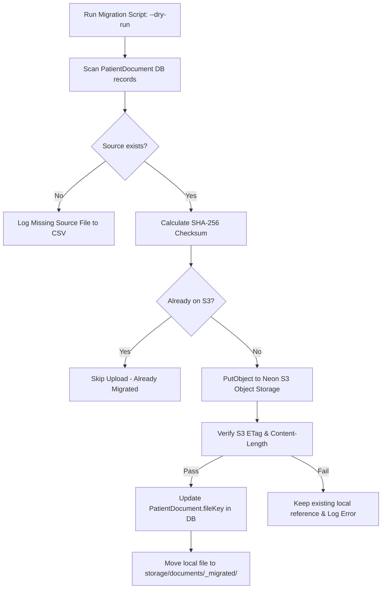

# DOCMATRIX — PATIENT DOCUMENT MIGRATION STRATEGY & RUNBOOK

**Date:** November 10, 2026  
**Auditor & Architect:** Cloud Storage Architect & Healthcare Data Security Engineer  
**Objective:** Non-destructive migration of legacy base64 data URLs and local disk documents into secure S3 cloud object storage.  
**Strict Policy:** No destructive mutations, zero downtime, idempotent batch processing, strict MD5/SHA-256 verification before reference flipping, and comprehensive rollback procedures.

---

## 1. Audit of Existing Legacy Documents

From Phase 1 of our audit, legacy documents exist in two distinct states:
1. **Browser LocalStorage / Client Cache:**
   - Base64 data URLs stored inside client-side `patientDocumentsState` (keyed by `docmatrix_clinic_data_<clinicId>`).
   - Files larger than the client threshold were ephemeral blob URLs (`blob:http...`), which expired when the tab was closed.
2. **Server Local Storage (`storage/documents/<clinicId>/`):**
   - Files uploaded during earlier phases that were written to local disk paths using simple UUIDs.
   - Database records in `PatientDocument` with `fileKey` referencing disk filenames.

---

## 2. Server-Side Migration Script & Pipeline

For documents present on server disk or in database records with existing base64 payloads, a dedicated Node.js migration script (`backend/scripts/migrate-documents-to-s3.mjs`) is specified below.

### 2.1 Non-Destructive Invariant Rules
1. **Never Delete the Source File:** The migration script uploads the file to S3, verifies the checksum, and updates `fileKey` in Prisma. The local disk file remains in `storage/documents/<clinicId>/backup/` for 90 days.
2. **Idempotency & Checksum Verification:**
   - Computes SHA-256 checksum of source file.
   - Uploads to S3 with metadata header `x-amz-meta-sha256`.
   - Downloads S3 object header via `HeadObjectCommand` and verifies matching ETag / size.
3. **Dry-Run Mode by Default:**
   - Executing without `--commit` performs a read-only audit: scanning files, calculating required S3 storage, and reporting anomalies without writing a single byte.

### 2.2 Server Migration Execution Flow



---

## 3. Browser-Side (Client-Assisted) Migration Protocol

### The Architectural Limitation of Server-Only Migration
Because base64 data URLs uploaded on individual clinic computers were cached in browser `localStorage`, a backend server cannot magically access files stored inside private web browsers without client participation.

### Safe User-Assisted Sync Workflow
When a clinic staff member logs into DocMatrix:
1. `clinicStore.ts` detects any legacy document record whose `url` starts with `data:image/` or `data:application/pdf` and whose `fileKey` does not match the cloud prefix `clinics/`.
2. A non-blocking background synchronization task dispatches:
   ```typescript
   POST /patients/:patientId/documents
   {
     title: doc.title,
     category: doc.category,
     fileName: doc.fileName,
     contentBase64: doc.url.split(',')[1],
     mimeType: doc.mimeType
   }
   ```
3. Upon receiving server confirmation (`HTTP 201 Created` with cloud `signedUrl`), the client updates the cached record from base64 to cloud reference.
4. **Storage Reclaimed:** Clearing base64 blobs frees up 4–8 MB of browser `localStorage`, preventing quota exhaustion.

---

## 4. Rollback & Disaster Recovery Procedures

If the cloud storage provider becomes unreachable or S3 configuration is altered:

1. **Immediate Fallback to Local Storage Provider:**
   - DocMatrix's `StorageService` automatically checks `s3Provider.isAvailable()`. If credentials or bucket are missing, it switches to `LocalStorageProvider` immediately without server downtime.
2. **Database Reference Rollback:**
   - Before any batch migration, an automated database snapshot of the `PatientDocument` table is exported to `storage/backups/patient_documents_backup_<timestamp>.json`.
   - Reverting is performed via:
     ```bash
     node backend/scripts/rollback-document-keys.mjs --snapshot=storage/backups/patient_documents_backup_20261110.json
     ```
3. **Preservation of Document History:**
   - Existing document IDs (`doc.id`), timestamps (`createdAt`), and patient relations (`patientId`) are never modified during migration.

---

## 5. Security & Privacy Safeguards During Migration

- **Zero Exposure of PHI in Logs:** Migration logs redact patient names, phone numbers, and diagnostic notes, logging only `clinicId`, `patientId` (UUID/code), and `documentId`.
- **Encrypted Transmission:** All migration streams use TLS 1.3 to the Neon S3 endpoint (`https://...storage.neon.tech`).
- **Authorization Check:** Every document is uploaded strictly within the bucket path corresponding to its tenant: `clinics/{clinicId}/...`.

