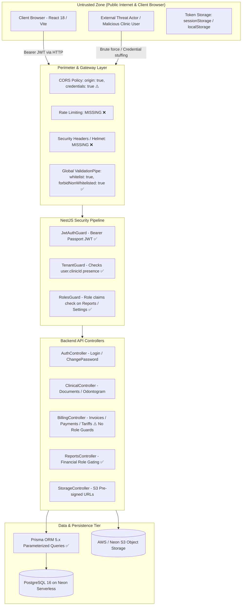

# DOCMATRIX MASTER SECURITY AUDIT & THREAT MODEL EVALUATION

**Date of Audit:** November 12, 2026  
**Auditor:** Senior Application Security Engineer, Security Architect & QA Security Lead  
**Application:** DocMatrix — Multi-Tenant Dental Practice Management SaaS  
**Primary Frameworks:** Vibe Coded App Security Checklist & Implementation Guide (November 2026), OWASP ASVS 5.0.0, OWASP API Security Top 10 (2023)  
**Audit Policy:** Strictly READ-ONLY. No code alterations, no database mutations, no destructive tests.

---

## 1. Executive Summary

DocMatrix is a cloud-based dental practice management SaaS platform handling highly sensitive Electronic Health Records (EHR), patient identities, radiographic imaging (DICOM, OPG, RVG), dental procedures, clinical SOAP notes, prescriptions, and financial billing.

This security evaluation assessed the end-to-end security posture of DocMatrix against the 10 categories of the *Vibe Coded App Security Checklist* and the 10 hardening phases of the *Vibe Coded App Security Guide*.

### Security Posture Verdict

| Environment | Verdict | Key Justification |
| :--- | :---: | :--- |
| **Internal Development** | **READY** | Fast in-memory demo mode, clean type checking, zero build errors, parameterized database access. |
| **Isolated Staging QA** | **READY** | Functional test baseline passes 314/314 automated tests; staging database migrations and isolated fixtures ready. |
| **Pilot Dental Clinic** | **CONDITIONALLY READY** | Must enforce production `JWT_SECRET`, enable rate limiting on `/auth/login`, and restrict billing mutation endpoints. |
| **Public Production** | **NOT READY** | Requires resolution of P0/P1 security findings (CORS wildcard origin reflection, missing Helmet security headers, missing JWT token invalidation on logout/password change, and missing role guards on billing writes). |

---

## 2. Architecture & Threat Model

### Threat Boundaries & Assets at Risk

1. **Patient Identifiable Information (PII) & Medical Records:**  
   - *Assets:* Names, phone numbers, medical alerts, dental charts, diagnoses, and prescriptions.  
   - *Threat Actors:* Disgruntled staff, rogue clinic tenants, external attackers.  
   - *Trust Boundary:* Cross-clinic isolation enforced at the controller and query level via `where: { clinicId }`.
2. **Financial Records & Transaction Integrity:**  
   - *Assets:* Invoices, collections, outstanding dues, tariff price lists, cash receipts.  
   - *Threat Actors:* Low-privilege staff (receptionists/assistants) performing unauthorized fee adjustments, voiding invoices, or issuing fraudulent refunds.  
   - *Trust Boundary:* Enforced on `/reports/revenue` via `RolesGuard`, but **missing** on `/billing/invoices/issue`, `/billing/invoices/:id/void`, and `/billing/payments/:id/refund`.
3. **Authentication & Session Tokens:**  
   - *Assets:* 7-day stateless JWT tokens.  
   - *Threat Actors:* Session hijackers, physical device snooping.  
   - *Trust Boundary:* Token stored in browser `sessionStorage`/`localStorage`; lacks backend token invalidation/revocation on logout or password change.

---

## 3. High-Level Findings Summary

- **Total Checklist Items Evaluated:** 76 Controls
- **Passed Applicable Controls:** 48 Controls (**63.2%**)
- **Partial Controls:** 12 Controls (**15.8%**)
- **Failed Controls:** 16 Controls (**21.0%**)
- **Confirmed Vulnerabilities:** 8 Findings
- **Potential Vulnerabilities / Risks:** 6 Findings
- **Critical Vulnerabilities:** 0 Actively Exploitable Remote Code Execution / Injection
- **High Severity Vulnerabilities:** 4 Findings

---

## 4. Top 10 Security Risks

1. **`SEC-001` (HIGH) — Overly Permissive CORS Origin Reflection:**  
   In [`main.ts`](file:///c:/Users/user/Documents/White%20Matrix%20Files/doc%20matrix/Doc_matrix-main/Doc_matrix-main/backend/src/main.ts#L8-L11), `app.enableCors({ origin: true, credentials: true })` reflects the incoming request origin without domain allowlisting. In combination with credential reflection, malicious external origins could execute authenticated cross-origin requests.
2. **`SEC-002` (HIGH) — Hardcoded JWT Secret Fallback:**  
   In [`auth.module.ts`](file:///c:/Users/user/Documents/White%20Matrix%20Files/doc%20matrix/Doc_matrix-main/Doc_matrix-main/backend/src/auth/auth.module.ts#L12) and [`jwt.strategy.ts`](file:///c:/Users/user/Documents/White%20Matrix%20Files/doc%20matrix/Doc_matrix-main/Doc_matrix-main/backend/src/auth/jwt.strategy.ts#L20), the system defaults to `'docmatrix_jwt_development_secret_key_2026'` if `JWT_SECRET` is omitted. If deployed without setting `JWT_SECRET`, attackers can forge arbitrary valid JWTs for any user ID and clinic ID.
3. **`SEC-003` (HIGH) — Missing Role-Based Authorization on Billing Mutations (BFLA):**  
   In [`BillingController`](file:///c:/Users/user/Documents/White%20Matrix%20Files/doc%20matrix/Doc_matrix-main/Doc_matrix-main/backend/src/billing/billing.controller.ts), endpoints for creating invoices, voiding invoices, recording refunds, and updating price tariffs only verify authentication and clinic membership (`@UseGuards(JwtAuthGuard, TenantGuard)`), lacking `@Roles(...)` decorators. Any authenticated staff role (including receptionists and nurses) can invoke financial write actions.
4. **`SEC-004` (HIGH) — Stateless 7-Day Tokens Without Server-Side Revocation:**  
   JWTs have a 7-day validity period without refresh-token rotation. In [`AuthService.revokeSessions`](file:///c:/Users/user/Documents/White%20Matrix%20Files/doc%20matrix/Doc_matrix-main/Doc_matrix-main/backend/src/auth/auth.service.ts#L304), revoking sessions only writes a file log to disk; existing JWTs remain valid until their expiration timestamp.
5. **`SEC-005` (MEDIUM) — Missing Rate Limiting and Brute-Force Protection:**  
   Neither global nor route-specific rate limiting (`@nestjs/throttler`) is configured on `/auth/login`, `/auth/change-password`, or `/enquiries`, leaving the application open to automated credential stuffing.
6. **`SEC-006` (MEDIUM) — Missing HTTP Security Response Headers (Helmet):**  
   The backend API does not employ `helmet()`. Standard defensive response headers (`X-Content-Type-Options`, `Strict-Transport-Security`, `X-Frame-Options`, `Content-Security-Policy`) are omitted.
7. **`SEC-007` (MEDIUM) — Unpinned JWT Algorithm:**  
   In [`jwt.strategy.ts`](file:///c:/Users/user/Documents/White%20Matrix%20Files/doc%20matrix/Doc_matrix-main/Doc_matrix-main/backend/src/auth/jwt.strategy.ts#L17), `PassportStrategy` does not explicitly pin `algorithms: ['HS256']`, leaving token decoding vulnerable to algorithm confusion if headers are tampered with.
8. **`SEC-008` (MEDIUM) — Local Storage File Leakage Risk in Multi-Instance Environments:**  
   When S3 credentials are missing, [`StorageService`](file:///c:/Users/user/Documents/White%20Matrix%20Files/doc%20matrix/Doc_matrix-main/Doc_matrix-main/backend/src/storage/storage.service.ts#L38) writes patient radiographs and PDFs to `backend/storage/`. In containerized or load-balanced deployments, local storage creates split-brain state and potential unauthorized access if container storage is not isolated.
9. **`SEC-009` (LOW) — Account Enumeration via Clinic Registration:**  
   In [`AuthService.registerClinic`](file:///c:/Users/user/Documents/White%20Matrix%20Files/doc%20matrix/Doc_matrix-main/Doc_matrix-main/backend/src/auth/auth.service.ts#L143), registering an existing email throws `ConflictException('A user with this email address already exists.')`, allowing malicious actors to enumerate registered clinic emails.
10. **`SEC-010` (LOW) — Unvalidated Input in Inventory Batch & Item Updates:**  
    In [`InventoryController`](file:///c:/Users/user/Documents/White%20Matrix%20Files/doc%20matrix/Doc_matrix-main/Doc_matrix-main/backend/src/inventory/inventory.controller.ts#L39-L55), `@Patch('items/:id')` accepts `@Body() dto: any` without class-validator schemas.

---

## 5. Security Posture Assessment & Strengths

1. **SQL Injection Immunity via Prisma ORM:**  
   All database operations utilize Prisma ORM parameterized queries or strict query builders. Zero raw string concatenation queries were found.
2. **Strict Multi-Tenant Database Modeling:**  
   Prisma models enforce compound constraints (`@@unique([id, clinicId])`, `@@unique([clinicId, patientCode])`), providing database-level protection against accidental cross-tenant data leakage.
3. **Magic-Byte File Content Verification:**  
   [`StorageService.validateFile`](file:///c:/Users/user/Documents/White%20Matrix%20Files/doc%20matrix/Doc_matrix-main/Doc_matrix-main/backend/src/storage/storage.service.ts#L61) inspects magic bytes (PDF, PNG, JPEG, WEBP, DICOM) and rejects dangerous executable extensions (`.exe`, `.sh`, `.php`, `.svg`), preventing stored XSS or malicious payload hosting.
4. **Zero Frontend Secret Leaks:**  
   Vite builds contain zero private keys, API secrets, or database URLs. `dangerouslySetInnerHTML` is completely absent from `src/`.
5. **Financial Gating on Reports:**  
   [`ReportsController`](file:///c:/Users/user/Documents/White%20Matrix%20Files/doc%20matrix/Doc_matrix-main/Doc_matrix-main/backend/src/reports/reports.controller.ts) strictly enforces role-based financial access on the backend, preventing unauthorized roles from querying raw clinic revenue.

